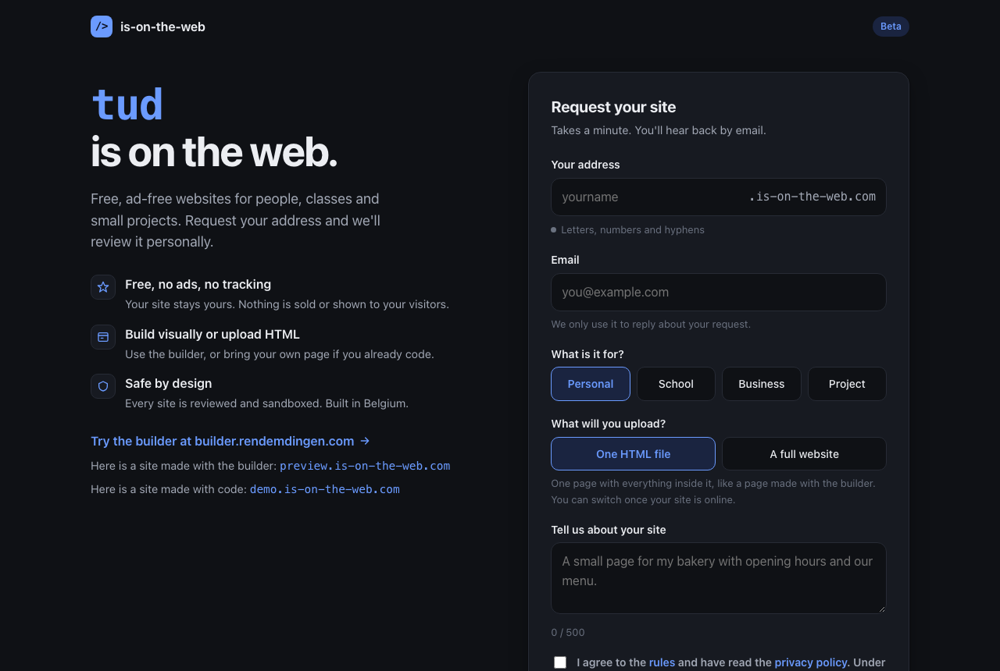
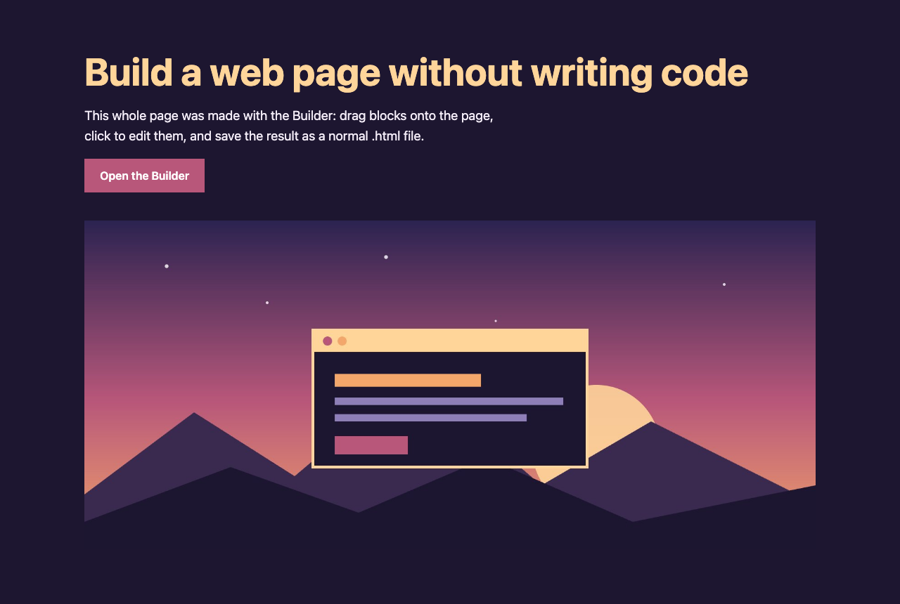

  

<h1 align="center">is-on-the-web</h1>

  <b>Free, ad-free websites for people, classes and small projects.</b> 
  Get your own address like <code>yourname.is-on-the-web.com</code>.

  <a href="https://is-on-the-web.com"><b>Request a site</b></a> ·
  <a href="https://builder.rendemdingen.com">Try the builder</a> ·
  <a href="https://is-on-the-web.com/rules">Rules</a> ·
  <a href="https://is-on-the-web.com/privacy">Privacy</a>

---

## What you get

- **Your own address**: `yourname.is-on-the-web.com`, with HTTPS.
- **Free, no ads, no tracking**: nothing is sold, and visitors get no cookies.
- **One page or a full website**: upload a single HTML file, or a folder (or .zip) with pages, styles, scripts, images, fonts, sound and video. Up to 20 MB.
- **No code needed**: make a page with the free visual [builder](https://builder.rendemdingen.com), then upload it.
- **Safe by design**: every request and every upload is checked by a person, and every site runs in a sandbox.
- **Made for schools too**: a teacher can request a site and give the upload key to a student.
- **Built and hosted in Belgium**.

## How it works

1. **Request your address** on [is-on-the-web.com](https://is-on-the-web.com). It takes a minute.
2. **Get approved**: requests are reviewed by hand, and you get an email with your upload key. (Check your junk or spam folder too.)
3. **Upload your site** with that key. After a last check, it's online.

## See it in action

| Made with code | Made with the builder |
|---|---|
|  |  |
| [demo.is-on-the-web.com](https://demo.is-on-the-web.com) | [preview.is-on-the-web.com](https://preview.is-on-the-web.com) |

## Good to know

- Sites are **static**: HTML, CSS, JavaScript and your own files. Everything has to be inside your upload, nothing loaded from other websites.
- Cookies, browser storage and forms don't work on purpose, because of the sandbox.
- Links to other websites are fine. Redirects, phishing, spam and adult content are not. Read the full [rules](https://is-on-the-web.com/rules).
- is-on-the-web is in **beta**.

## Questions or a problem?

Open an [issue](../../issues) here, or use the **Report abuse** link at the bottom of [is-on-the-web.com](https://is-on-the-web.com) to report a site.

---

This repository is for information and questions only. The source code of the service is not published.
